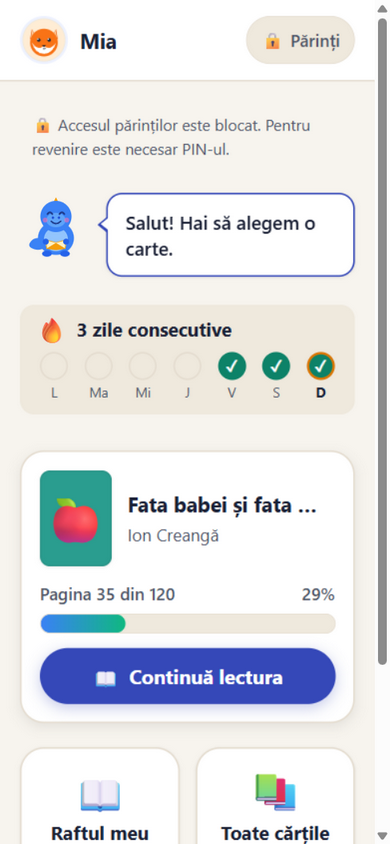
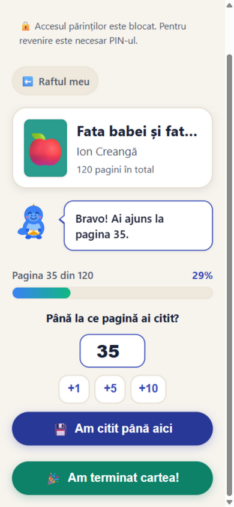
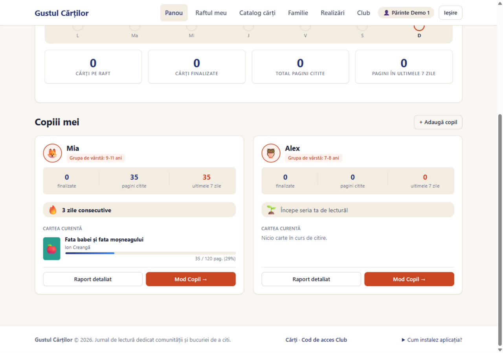

# Gustul Cărților — jurnal de lectură pentru familii


**Gustul Cărților** e un jurnal de lectură în limba română pentru familiile cu copii (7–15 ani):
copilul citește o carte **tipărită** și își notează singur progresul pagină cu pagină, iar părintele
vede totul într-un **raport privat al familiei** — fără profiluri publice, fără feeduri, fără presiune.
Clubul de lectură rămâne conectat prin coduri unice și activități dedicate.

🏆 **Locul II la Impact Hackathon 2026** — prototip funcțional demonstrat în finală.

👉 **[Deschide demo-ul](https://gustul-cartilor.onrender.com/cont/inregistrare/)** — înregistrare
liberă, direct din browser. Prima încărcare după o pauză poate dura ~30 s (hosting gratuit cu „cold start").

| Mod copil — acasă | Momentul de lectură |
|---|---|
|  |  |

*Capturi locale cu date sintetice — proveniența completă în [`docs/demo/screenshots/readme-89/`](docs/demo/screenshots/readme-89/README.md).*

## Încearcă aplicația

1. Deschide [înregistrarea](https://gustul-cartilor.onrender.com/cont/inregistrare/) și creează un cont
   de adult (email, nume, parolă) — intri direct în panou, fără confirmare pe email.
2. La **Familie**, adaugă un copil (poreclă, grupă de vârstă, avatar) și setează un PIN de 4–6 cifre.
3. Apasă **Mod Copil** — copilul alege o carte din catalog și salvează pagina până unde a citit.
4. Revino în zona părinților (cere PIN-ul) și vezi progresul în raportul copilului.

Catalogul de cărți e [public](https://gustul-cartilor.onrender.com/carti/) — îl poți răsfoi și fără cont.

## Cum arată raportul părintelui



*Captură locală sintetică: panoul părintelui arată progresul 35/120 (29%) și seria de lectură. Sincronizarea între două sesiuni independente pe hostul public este documentată separat în [ledger](docs/demo/acceptance-ledger.md); această captură nu reprezintă acea verificare.*

## Ce funcționează azi

Tot ce urmează e **implementat în `main` și acoperit de teste automate** (suitele rulează în CI la
fiecare PR); parcursul B1–B3 a fost verificat și **în browser, pe hostul public** (01.11.2026 —
dovezi în [`acceptance-ledger.md`](docs/demo/acceptance-ledger.md)):

- **Familie, nu social media** — părintele creează profiluri de copii; fiecare familie vede doar datele ei (izolare pe server).
- **Progres real, pagină cu pagină** — copilul salvează pagina curentă (ex. 35/120); salvarea e idempotentă și rezistă la rețea slabă.
- **Raport privat al părintelui** — sesiune separată, cu PIN la revenirea din modul copil.
- **Seria de zile citite** — „3 zile consecutive" cu săptămâna vizuală, pentru copil și părinte.
- **Insigne și evaluări** — „Prima carte", „100 de pagini"; evaluare 1–5 stele după terminarea cărții, medii afișate doar de la 3 evaluări.
- **Gânduri despre carte** — 4 întrebări private de reflecție la final, păstrate în jurnal.
- **Colțul clubului** — staff-ul emite coduri single-use (doar hash în DB); membrii deblochează activitățile, non-membrii primesc un 403 clar.
- **PWA instalabilă** — manifest, service worker și pagină offline pregătite; instalarea pe telefon fizic e încă neverificată (vezi limite).

## Pentru cine și de ce e diferit

- Se citesc **cărți fizice** — familia le împrumută sau le cumpără singură; aplicația ține jurnalul, nu înlocuiește lectura.
- **Privat de la început** — fără profiluri publice de copii, fără mesagerie, fără feeduri.
- **În română**, gândit pentru familii și pentru cluburile de lectură care le însoțesc.
- **Copilul are propriul ecran** — mod copil cu mascota Gusti și butoane mari — iar părintele rămâne mereu în control.

## Siguranță și confidențialitate

- Fără profiluri publice ale copiilor și fără mesagerie deschisă; datele familiei sunt izolate pe server.
- Ieșirea din modul copil cere **PIN**; după deblocare există o fereastră scurtă de încredere, cu buton
  de **Blocare**. *PIN-ul protejează navigarea din modul copil — nu verifică vârsta sau identitatea.*
- Sesiunea de autentificare ține până la 30 de zile — *asta e comoditatea de login, nu o politică de
  stocare sau ștergere a datelor copiilor.*
- Nicio certificare GDPR/compliance nu e revendicată. Pe hostul public înregistrarea e deschisă, iar
  datele de demonstrație sunt sintetice.
- Auditul de safeguarding al copiilor: [`docs/reviews/2026-10-31-issue-44-child-safeguarding-igor.md`](docs/reviews/2026-10-31-issue-44-child-safeguarding-igor.md).

## Rulare locală (Python 3.12 + uv)

```bash
git clone https://github.com/Slave-of-Skynet/Impact-Hackathon-2026.git
cd Impact-Hackathon-2026
cp .env.example .env                # valori locale; nu comite niciodată .env
uv sync --frozen                    # dependențe lock-uite
uv run python manage.py migrate     # SQLite local disposable (db.sqlite3, git-ignored)
uv run python manage.py seed_demo   # date sintetice idempotente
uv run python manage.py runserver   # http://127.0.0.1:8000 (health: /healthz/)
uv run pytest                       # suita completă
```

- Fără `DEMO_PASSWORD`, conturile seed primesc parole inutilizabile; fără `DEMO_PIN`, părinții demo nu
  au PIN. Alternativa de intrare rămâne înregistrarea normală din UI.
- `seed_demo --reset` șterge toate conturile `@demo.local` și datele lor — **doar pe o bază locală
  disposable** (refuză dacă există conturi non-demo); niciodată pe host sau o bază partajată.
- Pe Windows există 4 eșecuri **pre-existente** doar-Windows în `tests/test_review_fixes.py`;
  sursa de adevăr e CI-ul Ubuntu pe fiecare PR.
- Deploy real (Render + PostgreSQL): [`docs/demo-deployment.md`](docs/demo-deployment.md).

## Configurare

| Variabilă | Rol | Local | Producție |
|---|---|---|---|
| `DJANGO_SECRET_KEY` | semnarea sesiunilor/CSRF | fallback nesigur, doar dev | **obligatorie** |
| `DATABASE_URL` | baza de date | gol = SQLite local | **obligatorie** — PostgreSQL (SQLite refuzat) |
| `DJANGO_ALLOWED_HOSTS` | hosturi permise (listă) | opțional | setată de operator; Render își adaugă automat hostname-ul extern |
| `DJANGO_CSRF_TRUSTED_ORIGINS` | origini https de încredere | opțional | setată de operator; Render își adaugă automat URL-ul extern |
| `DEMO_PASSWORD` | parola conturilor `seed_demo` | opțional | doar la seed |
| `DEMO_PIN` | PIN-ul părinților din seed (4–6 cifre) | opțional | doar la seed |

`DJANGO_SETTINGS_MODULE` **nu se citește din `.env`** (env-ul e încărcat abia după alegerea
settings-urilor): `manage.py` pornește implicit `config.settings.dev`, iar `config/wsgi.py`
(gunicorn) pornește `config.settings.prod`.

## Arhitectură

Django 5.2 LTS + HTMX 2.x + PWA instalabilă pe Python 3.12, gestionată cu `uv`. Patru aplicații:
`accounts` (identitate, PIN, mod copil) · `library` (catalog, raft, progres) · `club` (membru,
coduri, insigne) · `core` (landing, home copil, mascota, PWA). Deciziile: [ADR-0001](docs/adr/0001-architecture-gustul-cartilor-mvp.md) ·
specificația: [`specs/001-reading-diary-mvp/`](specs/001-reading-diary-mvp/spec.md).

## Stare și limite cunoscute

**Verificat** — CI verde pe `main` (badge mai sus); host public live, `/healthz/` OK (verificat prin
HTTP la 01.11.2026); B1 (progresul copilului vizibil în sesiunea părintelui), B2 (parcurs complet
signup → copii → PIN → lectură → finiș → insigne → reflecție → evaluare) și B3 (PIN la ieșire,
fereastră de încredere, Blocare) — trecute **în browser pe hostul public** la 01.11.2026, cu dovezi
în [ledger](docs/demo/acceptance-ledger.md); cold start măsurat ~32 s după inactivitate.

**În verificare (`NOT RUN`)** — răscumpărarea codului de club pe host (necesită cod emis de staff);
instalarea PWA + offline pe **telefon Android fizic**; persistența reală după restart/redeploy Render;
fiabilitatea cu 5 dispozitive; repetiția cronometrată a pitch-ului. Criterii și registru:
[`acceptance-ledger.md`](docs/demo/acceptance-ledger.md).

**De decis** — drepturile celor 12 coperți scanate din `static/img/covers/` (`RIGHTS_UNVERIFIED`,
decizie de conținut deschisă); README-ul nu folosește acele coperți. Licența MIT a codului
original nu schimbă statutul juridic al acestor imagini.

## Ce nu e în MVP

Plăți, mesagerie/DM, profiluri publice de copii, verificare de vârstă sau identitate, quizuri AI,
schimb de cărți între utilizatori, coordonarea întâlnirilor offline — excluse intenționat. Pașii
următori posibili sunt **doar propuneri**, condiționate de consimțământ, confidențialitate și
validarea partenerului: un pilot real cu familii, clarificarea drepturilor pentru coperți și exploatarea pe mobil.

## Echipa

- **[Vladimir Barbalat](https://github.com/barbalatv)** — interfața adultului, PWA, integrarea finală.
- **[Alisa](https://github.com/lisqrn)** — domeniul lecturii: raft, progres, salvări sigure sub concurență.
- **[Arsenii](https://github.com/arseniistrokov)** — fundația: identitate, mod copil, PIN, seria de zile.
- **[Denis](https://github.com/denis100strike)** — experiența copilului: mascota, tema caldă de poveste, evaluările cu stele.
- **[Igor](https://github.com/IgorGlUTMStudent)** — clubul: coduri, insigne, auditul de siguranță al copiilor.

Fiecare livrare a trecut prin review independent și testare automată în CI.

## Documentație

- [Workflow de dezvoltare](docs/development-workflow.md) — Spec Kit, integrări agent, procesul Git
- [ADR-0001 — arhitectura MVP](docs/adr/0001-architecture-gustul-cartilor-mvp.md)
- [Specificația MVP](specs/001-reading-diary-mvp/spec.md)
- [Ledger-ul de acceptanță](docs/demo/acceptance-ledger.md) — dovezi demo și dispozitiv
- [Deploy & operații](docs/demo-deployment.md)
- [Pitch-ul echipei (RO)](docs/demo/pitch-ro.md)

## Licență

Codul original și documentația create de echipă sunt distribuite sub [licența MIT](LICENSE).

Materialele terțe își păstrează propriile drepturi. În special, cele 12 coperți scanate din
`static/img/covers/` au statutul `RIGHTS_UNVERIFIED` și **nu sunt oferite sub licența MIT**.
Nu reutiliza aceste imagini fără clarificarea drepturilor corespunzătoare.
