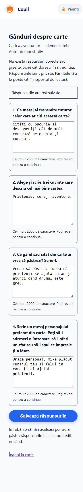
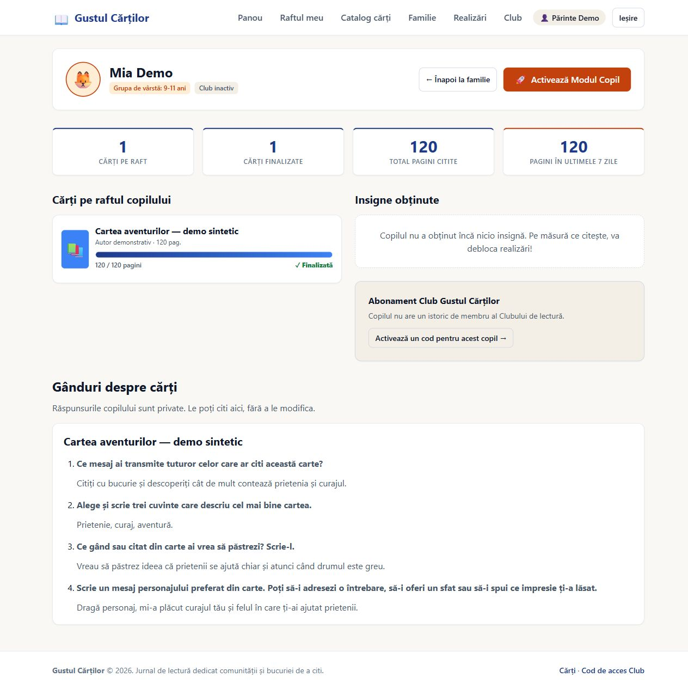

# Issue #63 — local browser and acceptance evidence

The feature is **not claimed live**. Browser evidence uses only synthetic
accounts, a synthetic book and invented answers in an isolated ignored SQLite
database on localhost. No real child data or production database was used.

## Browser walkthrough executed

1. Sign in through the real email/password form; enter Mia Demo's child mode.
2. Open the synthetic 120-page book. Submit the real finish form over HTMX.
   Stored progress becomes120/120 and the `Gânduri despre carte` link appears.
3. Open the reflection page; POST `Alege patru întrebări`. Four distinct numbered
   prompts appear in persisted order, each with an accessible labelled textarea.
4. Enter four invented Romanian answers and submit the native Save form. Follow
   PRG; `Răspunsurile au fost salvate.` appears, and all four values remain.
5. Reload at360px: same prompts/order/answers, no repeated success claim. Resize
   to430px and verify the layout. No physical phone was used.
6. Follow the parent link, submit the real guardian PIN, reach adult dashboard.
7. Stop and restart the local Django process with the same isolated file DB.
   Open the owned-child report through the dashboard. All four answers remain;
   the reflection section contains four items, **zero forms and zero textareas**.
8. Restore the browser's viewport override after the check.

## Mobile evidence

Measured from the actual browser DOM; widths are CSS pixels. Scroll width is no
greater than viewport width, so none of the tested reflection views overflows
horizontally. Native textareas are at least140px tall; save button height52px.

| Viewport | Document scroll width | Questions | Save height | Screenshot |
|---|---:|---:|---:|---|
|390×844|390|4|52|[After committed save](child-saved-390.png)|
|360×800|345|4|52|[After refresh](child-refresh-360.png)|
|430×932|415|4|52|[Wide phone layout](child-refresh-430.png)|
|1280×900|—|4 read-only|—|[Guardian after server restart](guardian-report-after-restart.png)|

## Reproduction and automated oracle

The committed tests use the same real routes, templates, authz and middleware:
`tests/test_reflections.py`. They verify source fidelity against the independently
preserved16-line owner source, controlled sample/shuffle, persistent order,
five independent sessions,409 stale writes, original prompt/text preservation
after redraw conflicts,422 text retention, no old success toast on rejected
native POST, CSRF/expiry, ownership matrix, private/no-store, database constraints,
2000-char boundary, XSS escaping, constant report queries, actual post-commit
acknowledgement and migration preservation. File-backed subprocess tests exercise
simultaneous creates/saves and a real held SQLite write lock503/retry.

The initial focused run found the old-toast regression (one failed test). After
the fix the same focused command passed; this failure is not concealed.
Exact final command outputs and exact-head CI are recorded in the PR.

## Known limitations / live acceptance pending

Single set per entry, no attempt history; once an answer is saved, redraw is
disallowed, and all-blank saves are rejected. Source1+2 combining is the working
interpretation, not confirmed owner clarification. Conflicts require copying
text then reloading; there is no automatic merge/offline queue. PostgreSQL live
persistence, deployed static manifests, actual phone keyboards and live sessions
have not been tested here. Ratings PR66 merged during implementation; this branch
was rebased onto mainb40086b, reflection migration moved after rating migration,
and both migration probes restore all original leaves. Combined rating/reflection
checks are recorded in the PR. Ratings UI PR70 is separate; preserve the new
reflection link when integrating its progress partial changes.

After independent merge and verified Render SHA: rehearse child finish → create
four prompts → save → refresh/new device → owned parent report, check foreign
family/CSRF/expired session denials, private cache headers, PIN switching and #62
ratings independence. Never run production seed/reset/mutation stress tests.
