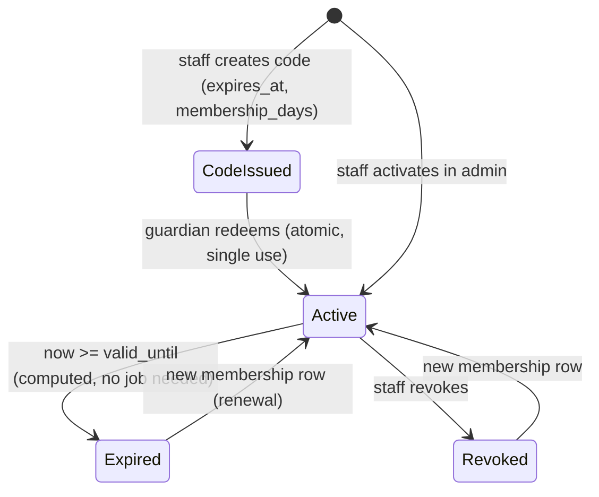

# Contract: authorization (proposal — decision gate)

Two **independent** axes, checked on the server on every request:

1. **Identity / relationship** — who is signed in and which readers they may act on (self, own children). Plus the **session mode** (`adult` / `child`).
2. **Entitlement** — does the *target reader* have active club membership *now*.

Staff (`is_staff`) is a third, back-office-only flag. It does not grant reader-level UI access.

## Enforcement points

| Layer | Mechanism | What it guarantees |
|---|---|---|
| Middleware `ChildModeMiddleware` | **Deny by default.** If `session.mode == "child"`, only URL names in `CHILD_ALLOWED = {child_home, catalog, book_detail, add_to_shelf, my_shelf, shelf_entry, record_progress, finish_book, achievements, club_corner, pin_gate, logout, offline, manifest, sw}` pass. Every other URL name, including routes added later, `/admin/` and unresolved paths, is refused: a normal request → 302 to `pin_gate`; an HTMX request → 403 with no partial (see *Session expiry and HTMX*). `logout` is allowed because it ends the **whole** session: it is the recovery path, not a way into adult mode | Child cannot reach adult/staff routes by URL (FR-005); new routes are blocked until someone adds them to the allow-list on purpose |
| `authz.current_reader(request)` | Adult mode → own reader; child mode → `session.active_child` reader **re-validated** against `child.guardian == request.user` on every request | No reader ID ever trusted from client |
| `authz.get_child_for_guardian(request, public_id)` | `ChildProfile.objects.get(public_id=…, guardian=request.user)` else 404 | IDOR-safe lookups |
| `authz.get_entry_for_reader(reader, public_id)` | `ShelfEntry.objects.get(public_id=…, reader=reader)` else 404 | IDOR-safe lookups |
| `club.services.is_member(reader, now)` | DB query at request/evaluation time | Entitlement never cached on the client or session |
| DB constraints | unique keys, checks | Duplicate grants/entries/events impossible even if code has a bug |
| Admin | Django admin restricted to `is_staff`; child profiles shown read-only with nickname only | Back office separation |

UI hiding (not rendering adult links in child mode, greying out members-only items) is **cosmetic only** and never relied on.

## Matrix: actor × operation × resource

Actors: **V** visitor · **A** adult (adult mode) acting on own reader · **G** guardian (adult mode) acting on own child · **G'** another adult acting on someone else's child · **C** child mode (active child) · **C'** child mode targeting another reader · **S** staff in admin. "M" = target reader is an active member.

| Operation | V | A | G | G' | C | C' | S |
|---|---|---|---|---|---|---|---|
| View landing / catalog | ✅ | ✅ | ✅ | ✅ | ✅ | — | ✅ |
| Sign up / sign in | ✅ (login throttled) | — | — | — | ❌ sign-in/sign-up → PIN gate; logout ✅ (ends the whole session) | — | — |
| Create / rename / delete child | ❌ → login | ✅ (becomes G) | ✅ | ❌ 404 | ❌ → PIN gate | ❌ | ❌ via UI; admin read-only |
| Set PIN | ❌ | ✅ (password re-auth) | ✅ | — | ❌ → PIN gate | — | — |
| Start child mode | ❌ | — | ✅ (PIN set) | ❌ 404 | — (already) | — | — |
| Exit child mode | — | — | — | — | ✅ with the guardian PIN only; recovery = sign out, then full email + password sign-in | — | — |
| Add to shelf / record progress / finish | ❌ → login | ✅ own reader | ❌ in adult mode for a child (P0: progress is entered by the child in child mode) `[ASSUMPTION]` | ❌ 404 | ✅ active child only | ❌ 404 | ❌ |
| View shelf / stats / achievements | ❌ | ✅ own | ✅ own children (report page) | ❌ 404 | ✅ own only | ❌ 404 | admin: aggregate only |
| Redeem membership code | ❌ | ✅ for self | ✅ for own child | ❌ (reader choice limited to own list; tampered → 404) | ❌ → PIN gate | ❌ | — |
| Activate / revoke membership, issue codes | ❌ | ❌ | ❌ | ❌ | ❌ | ❌ | ✅ |
| Members-only page | ❌ | ✅ if M | ✅ (report shows status) | ❌ | ✅ if M | ❌ | — |
| Receive club achievement | ❌ | only if M at evaluation | only if child M | ❌ | only if M at evaluation | ❌ | ❌ (no manual grant UI in P0) |
| Grant any achievement via request | ❌ | ❌ | ❌ | ❌ | ❌ | ❌ | ❌ (no such endpoint) |
| Public profile / leaderboard / feed / DM | — | — | — | — | — | — | — (not built; G5) |

## Child mode on a shared device

- Entering child mode is a POST by a signed-in guardian; the session keeps the adult authenticated **but locked** behind the PIN gate.
- The session cookie is the same; the restriction is server-side (middleware), so opening a new tab or typing an adult URL still lands on the PIN gate.
- **Exit contract (single, PIN-only):** the PIN gate (`/parinte/`) accepts only `pin`. A correct PIN clears child mode and resets the `pin` throttle. A wrong PIN → 422 "PIN greșit" and a counted failure. After 5 failures the gate is locked for 5 minutes (429 with the remaining time); during the lock even the correct PIN is refused. The counter is stored per **account** in `accounts.Throttle` (scope `pin`), so a new tab or a new session does not reset it. The password is **not** accepted on the PIN gate.
- **Recovery (forgotten PIN or locked gate):** the PIN gate shows "Am uitat PIN-ul — ieși din cont". It POSTs to `logout`, which ends the whole session (adult authentication and child mode). Coming back needs a full email + password sign-in (login throttle applies), and the guardian then sets a new PIN at `/familie/pin/` (password re-auth). This gives a child nothing: signing out only removes access. Accepted side effect: a child can sign the guardian out on a shared phone.
- Session lifetime: 30 days sliding for convenience `[ASSUMPTION]`; logout clears everything.
- Residual risk (documented, accepted for demo): a child who knows the PIN can exit; a lost phone with an active session exposes that family's data — mitigated by guardian logout from another device (P1: "sign out everywhere").

## Session expiry and HTMX

Rule: **no success UI without a committed write.** A failed, refused or redirected write must never look saved.

| Request | Not signed in / session expired | Signed in, but refused by child mode | CSRF failure |
|---|---|---|---|
| Normal page or form POST | 302 → `login?next=<path>` | 302 → `pin_gate` | 403 page |
| HTMX request (`HX-Request: true`) | **401**, empty body, header `HX-Redirect: /cont/intrare/?next=<page>`; never a 302 that HTMX would follow and swap as a 200 | **403**, empty body, no partial | 403, no partial |

- Server: one `htmx_auth_guard` (in `ChildModeMiddleware` plus the login-required decorator) returns these codes. Success partials are rendered only by the view after its service call commits.
- Client (`static/js/app.js`): HTMX does not swap 4xx/5xx by default. On `htmx:responseError` / `htmx:sendError` the client shows the "Nu s-a salvat" toast and leaves the progress bar unchanged. On 401 it then follows `HX-Redirect` to sign in. The "saved" toast and mascot line are triggered **only** by the response header `HX-Trigger: saved`, which only a committed write sets. A 200 without that header (for example a login page reached some other way) never shows "saved".
- Planned tests (NOT RUN): `test_child_mode.py::test_htmx_mutation_without_session_is_401_no_partial`, `::test_htmx_mutation_after_session_expiry_stores_nothing`, `::test_htmx_adult_route_in_child_mode_is_403`, `::test_saved_trigger_only_after_commit`.

## Brute-force limits (three separate throttles)

All three use `accounts/throttle.py` and the `accounts.Throttle` table ([data-model.md](../data-model.md)). Counters live in the database, so they survive a restart and are shared by all workers. None of them is provided by stock Django: stock `LoginView` has **no** rate limit, so login gets its own view.

| Throttle | Scope key | Limit | While locked | Reset | Owner / tests (all NOT RUN) |
|---|---|---|---|---|---|
| **Login** (`accounts.views.ThrottledLoginView`, subclass of `LoginView`) | normalized email (also unknown emails) | 5 failures in 15 min → locked 15 min | 429 "Prea multe încercări, încearcă peste N min", even with the right password; same generic text for unknown emails | successful login; window expiry | Arsenii, PR-2 · `test_login_throttle.py::test_sixth_attempt_locked_even_if_correct`, `::test_success_resets_counter`, `::test_lock_expires_after_15_min`, `::test_other_email_unaffected`, `::test_unknown_email_same_response` |
| **Guardian PIN** (`pin_gate`) | account | 5 failures → locked 5 min | 429 with remaining time + recovery link | correct PIN; lock expiry | Arsenii, PR-2 · `test_child_mode.py::test_pin_wrong_counts`, `::test_pin_lockout_after_5`, `::test_correct_pin_refused_while_locked`, `::test_pin_lock_expires`, `::test_logout_recovery_ends_session` |
| **Membership code** (`redeem_code`) | account | 5 failures in 15 min → refused until the window ends | 429; one generic message for unknown/used/expired codes | successful redemption; window expiry | Igor, PR-5 · `test_membership.py::test_redeem_failures_throttled`, `::test_redeem_lock_expires`, `::test_generic_error_for_all_bad_codes` |

Residual risk (documented): no per-IP limit in P0, because the client IP behind the host's proxy is not verified (see host proof). An attacker trying one password against many emails is not slowed down, and a known email can be locked out for 15 minutes on purpose. Before real internet-facing use (beyond the demo), add a per-IP limit once the host's client-IP header is confirmed.

## Membership lifecycle

Spoofing defences: no client-side membership flag; `is_member` queried per request; codes hashed, single-use via conditional `UPDATE`, failures throttled (`redeem` scope); achievement grants only from `evaluate_achievements` with DB uniqueness.

## Frozen vs gated

| Part | Status after review |
|---|---|
| Reader abstraction, ownership function, 404-on-foreign rule, no-client-entitlement rule, uniqueness constraints | **Can be accepted as working contract** for implementation |
| Single guardian, guardian-created child, no child credentials | Working contract for demo; **G2** before real users |
| Code-based membership + admin activation, 90-day default, keep badges after revocation | Working contract for demo; **G3/G4** before real launch |
| Who may enter progress for a child (child only vs guardian too) | Working assumption; cheap to change (one authz rule) |
| Any public visibility of minors | **Closed** until G5 |
