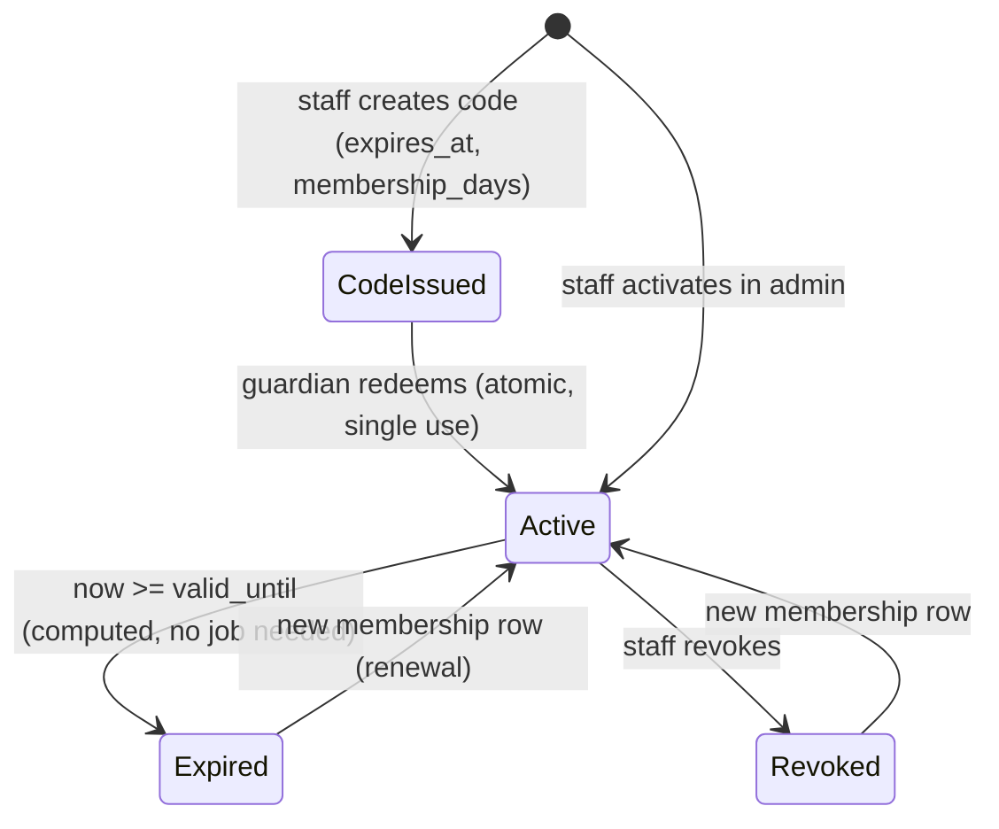

# Contract: authorization (proposal — decision gate)

Two **independent** axes, checked on the server on every request:

1. **Identity / relationship** — who is signed in and which readers they may act on (self, own children). Plus the **session mode** (`adult` / `child`).
2. **Entitlement** — does the *target reader* have active club membership *now*.

Staff (`is_staff`) is a third, back-office-only flag. It does not grant reader-level UI access.

## Enforcement points

| Layer | Mechanism | What it guarantees |
|---|---|---|
| Middleware `ChildModeMiddleware` | If `session.mode == "child"`, only URL names in `CHILD_ALLOWED = {child_home, catalog, book_detail, add_to_shelf, my_shelf, shelf_entry, record_progress, finish_book, achievements, club_corner, pin_gate, offline, manifest, sw}` pass; everything else → redirect `pin_gate`. `logout` is **not** allowed in child mode (would bypass the PIN) | Child cannot reach adult/staff routes by URL (FR-005) |
| `authz.current_reader(request)` | Adult mode → own reader; child mode → `session.active_child` reader **re-validated** against `child.guardian == request.user` on every request | No reader ID ever trusted from client |
| `authz.get_child_for_guardian(request, public_id)` | `ChildProfile.objects.get(public_id=…, guardian=request.user)` else 404 | IDOR-safe lookups |
| `authz.get_entry_for_reader(reader, public_id)` | `ShelfEntry.objects.get(public_id=…, reader=reader)` else 404 | IDOR-safe lookups |
| `club.services.is_member(reader, now)` | DB query at request/evaluation time | Entitlement never cached on the client or session |
| DB constraints | unique keys, checks | Duplicate grants/entries/events impossible even if code has a bug |
| Admin | Django admin restricted to `is_staff`; child profiles shown read-only with nickname only | Back office separation |

UI hiding (not rendering adult links in child mode, greying out members-only items) is **cosmetic only** and never relied on.

## Matrix: actor × operation × resource

Actors: **V** visitor · **A** adult (adult mode) acting on own reader · **G** guardian (adult mode) acting on own child · **G'** another adult acting on someone else's child · **C** child mode (active child) · **C'** child mode targeting another reader · **S** staff in admin. "M" = target reader is an active member.

| Operation | V | A | G | G' | C | C' | S |
|---|---|---|---|---|---|---|---|
| View landing / catalog | ✅ | ✅ | ✅ | ✅ | ✅ | — | ✅ |
| Sign up / sign in | ✅ | — | — | — | ❌ (logout & sign-in blocked in child mode) | — | — |
| Create / rename / delete child | ❌ → login | ✅ (becomes G) | ✅ | ❌ 404 | ❌ → PIN gate | ❌ | ❌ via UI; admin read-only |
| Set PIN | ❌ | ✅ (password re-auth) | ✅ | — | ❌ → PIN gate | — | — |
| Start child mode | ❌ | — | ✅ (PIN set) | ❌ 404 | — (already) | — | — |
| Exit child mode | — | — | — | — | ✅ with PIN/password only | — | — |
| Add to shelf / record progress / finish | ❌ → login | ✅ own reader | ❌ in adult mode for a child (P0: progress is entered by the child in child mode) `[ASSUMPTION]` | ❌ 404 | ✅ active child only | ❌ 404 | ❌ |
| View shelf / stats / achievements | ❌ | ✅ own | ✅ own children (report page) | ❌ 404 | ✅ own only | ❌ 404 | admin: aggregate only |
| Redeem membership code | ❌ | ✅ for self | ✅ for own child | ❌ (reader choice limited to own list; tampered → 404) | ❌ → PIN gate | ❌ | — |
| Activate / revoke membership, issue codes | ❌ | ❌ | ❌ | ❌ | ❌ | ❌ | ✅ |
| Members-only page | ❌ | ✅ if M | ✅ (report shows status) | ❌ | ✅ if M | ❌ | — |
| Receive club achievement | ❌ | only if M at evaluation | only if child M | ❌ | only if M at evaluation | ❌ | ❌ (no manual grant UI in P0) |
| Grant any achievement via request | ❌ | ❌ | ❌ | ❌ | ❌ | ❌ | ❌ (no such endpoint) |
| Public profile / leaderboard / feed / DM | — | — | — | — | — | — | — (not built; G5) |

## Child mode on a shared device

- Entering child mode is a POST by a signed-in guardian; the session keeps the adult authenticated **but locked** behind the PIN gate.
- The session cookie is the same; the restriction is server-side (middleware), so opening a new tab or typing an adult URL still lands on the PIN gate.
- PIN: 4–6 digits, hashed; 5 wrong attempts → 5-minute lock stored on the account (`pin_locked_until`). The full password is an alternative unlock.
- Session lifetime: 30 days sliding for convenience `[ASSUMPTION]`; logout clears everything. In child mode logout is blocked so a child cannot reach the sign-in page and try the guardian's password repeatedly; Django's login rate is additionally limited.
- Residual risk (documented, accepted for demo): a child who knows the PIN can exit; a lost phone with an active session exposes that family's data — mitigated by guardian logout from another device (P1: "sign out everywhere").

## Membership lifecycle

Spoofing defences: no client-side membership flag; `is_member` queried per request; codes hashed, single-use via conditional `UPDATE`, rate-limited; achievement grants only from `evaluate_achievements` with DB uniqueness.

## Frozen vs gated

| Part | Status after review |
|---|---|
| Reader abstraction, ownership function, 404-on-foreign rule, no-client-entitlement rule, uniqueness constraints | **Can be accepted as working contract** for implementation |
| Single guardian, guardian-created child, no child credentials | Working contract for demo; **G2** before real users |
| Code-based membership + admin activation, 90-day default, keep badges after revocation | Working contract for demo; **G3/G4** before real launch |
| Who may enter progress for a child (child only vs guardian too) | Working assumption; cheap to change (one authz rule) |
| Any public visibility of minors | **Closed** until G5 |
