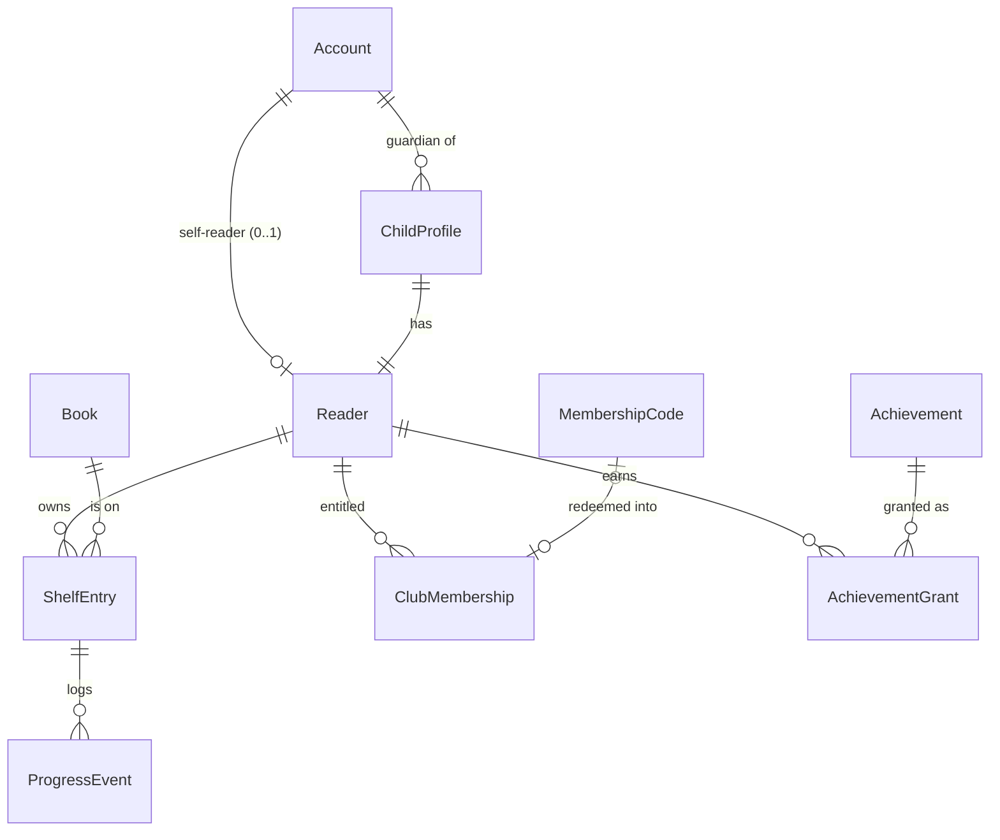

# Data model (proposal — shared contract, decision gate)

**Status**: proposed for review; becomes the single source of truth once PR M0-1 (schema) merges. Any later change is a decision gate (constitution §III).

Conventions: Django ORM, integer primary keys internally, **UUID `public_id`** on every object referenced in URLs (no sequential IDs in URLs). All timestamps UTC. `on_delete` noted per FK.

## Entity overview

## Tables

### `accounts.Account` (custom user model — must exist before the first migration)

| Field | Type | Rules |
|---|---|---|
| id | PK | |
| email | email, unique, case-insensitive | login identifier |
| password | hash | Django hasher |
| display_name | str ≤ 40 | shown only to the account holder |
| ui_language | enum `ro`/`ru` | default `ro` |
| pin_hash | str, nullable | set before first child mode (FR-004) |
| pin_failed_count, pin_locked_until | int, datetime nullable | lockout (FR-006) |
| is_staff | bool | club admin; **not** a reader role |
| date_joined | datetime | |

### `accounts.ChildProfile`

| Field | Type | Rules |
|---|---|---|
| id, public_id | PK, UUID unique | |
| guardian | FK Account, `CASCADE` | set from session only; never from form input |
| nickname | str 2–20 | not required to be a real name; no uniqueness across families |
| age_band | enum `7-8`, `9-11`, `12-15` | |
| avatar | enum (fixed list of ~8 drawn avatars) | no photo upload |
| ui_language | enum `ro`/`ru` | |
| created_at | datetime | |

Invariant: max 6 children per guardian (abuse limit) `[ASSUMPTION]`.

### `accounts.Reader`

| Field | Type | Rules |
|---|---|---|
| id, public_id | PK, UUID | |
| kind | enum `adult`/`child` | |
| account | OneToOne Account, nullable, `CASCADE` | set iff `kind=adult` |
| child | OneToOne ChildProfile, nullable, `CASCADE` | set iff `kind=child` |

DB check constraint: exactly one of `account`, `child` is non-null and matches `kind`. Created automatically with the account (lazily on first shelf action) or with the child.

**Ownership rule (single function, `accounts/authz.py`)**: an authenticated adult `A` may act on reader `R` iff `R.account == A` or `R.child.guardian == A`. In child mode the only permitted reader is `session.active_child_reader`.

### `library.Book`

| Field | Type | Rules |
|---|---|---|
| id, public_id | PK, UUID | |
| title, author | str | |
| language | enum `ro`/`ru`/`en` | |
| page_count | int | `CHECK page_count BETWEEN 1 AND 2000` |
| age_band | enum, nullable | recommendation only |
| genre | enum (small fixed list) | |
| cover_color, cover_emoji | str | generated cover; no copyrighted images in P0 |
| source_note | str | where the metadata came from / rights note |
| is_active | bool | admin can hide |

### `library.ShelfEntry`

| Field | Type | Rules |
|---|---|---|
| id, public_id | PK, UUID | |
| reader | FK Reader, `CASCADE` | |
| book | FK Book, `PROTECT` | |
| current_page | int | `CHECK current_page >= 0`; `<= book.page_count` enforced in service + test (cross-table) |
| status | enum `reading`/`finished` | |
| added_at, finished_at | datetime, nullable | `finished_at` set iff `status=finished` (check constraint) |

`UNIQUE (reader, book)` → duplicate add is a no-op (FR-011). Re-reading a finished book: deferred.

### `library.ProgressEvent` (append-only)

| Field | Type | Rules |
|---|---|---|
| id | PK | |
| entry | FK ShelfEntry, `CASCADE` | |
| reader | FK Reader, `CASCADE` | denormalized for the unique key and stats |
| from_page, to_page | int | |
| kind | enum `progress`/`finish` | |
| request_id | UUID | client-generated per submit |
| created_at | datetime | |

`UNIQUE (reader, request_id)` → idempotency (FR-014). Never updated or deleted except by cascade.

### `club.ClubMembership`

| Field | Type | Rules |
|---|---|---|
| id | PK | |
| reader | FK Reader, `CASCADE` | |
| status | enum `active`/`revoked` | |
| valid_from, valid_until | datetime | `CHECK valid_until > valid_from` |
| source | enum `admin`/`code` | |
| granted_by | FK Account (staff), nullable, `SET_NULL` | |
| code | OneToOne MembershipCode, nullable | |
| revoked_at, revoked_by | nullable | |

`is_member(reader, now)` = exists row with `status=active AND valid_from <= now < valid_until`. Computed per request; **never stored in the session or sent as a trusted client value**. Overlapping memberships allowed (renewal = new row).

### `club.MembershipCode`

| Field | Type | Rules |
|---|---|---|
| id | PK | |
| code_hash | str unique | SHA-256 of the normalized code; plaintext shown once in admin |
| label | str | e.g. "Grupa 9–11, noiembrie" (no child names) |
| expires_at | datetime | |
| membership_days | int | default 90 `[ASSUMPTION — G3]` |
| created_by | FK Account (staff) | |
| redeemed_at, redeemed_for | datetime nullable, FK Reader nullable | single use: redemption sets both atomically (`UPDATE … WHERE redeemed_at IS NULL`) |

### `club.Achievement` (seeded definitions)

| Field | Type | Rules |
|---|---|---|
| id, code | PK, slug unique | e.g. `first-book`, `pages-100`, `club-reader` |
| title, description | translatable str | |
| rule | enum `books_finished_gte`, `pages_total_gte`, `shelf_size_gte` | |
| threshold | int ≥ 1 | |
| members_only | bool | |
| icon | str | static asset name |

P0 seed: `first-book` (books_finished ≥ 1, general), `pages-100` (pages_total ≥ 100, general), `club-reader` (books_finished ≥ 1, **members_only**).

### `club.AchievementGrant`

| Field | Type | Rules |
|---|---|---|
| id | PK | |
| reader | FK Reader, `CASCADE` | |
| achievement | FK Achievement, `PROTECT` | |
| granted_at | datetime | |
| was_member | bool | snapshot for audit |

`UNIQUE (reader, achievement)` (FR-024). Created only by `club.services.evaluate_achievements(reader)`.

### `club.ClubActivity`

| Field | Type | Rules |
|---|---|---|
| id | PK | |
| title, description, place | translatable str | |
| starts_at | datetime | |
| is_published | bool | |

Visible only on the members-only page.

## Domain services (the only code allowed to write these tables)

| Service | Module | Writes | Transaction | Notes |
|---|---|---|---|---|
| `add_to_shelf(reader, book)` | `library/services.py` | ShelfEntry | atomic, `get_or_create` | idempotent |
| `record_progress(reader, entry, page, request_id)` | `library/services.py` | ShelfEntry, ProgressEvent, then calls `evaluate_achievements` | atomic, `select_for_update` on entry | returns `ProgressResult(entry, new_grants, replayed: bool)` |
| `finish_book(reader, entry, request_id)` | `library/services.py` | same | atomic | sets `current_page = page_count` |
| `reader_stats(reader)` | `library/stats.py` | — | read | books_on_shelf, books_finished, pages_total (= Σ current_page), pages_7d (Σ positive deltas in events, last 7 days) |
| `redeem_code(actor, reader, raw_code)` | `club/services.py` | MembershipCode, ClubMembership, then `evaluate_achievements` | atomic, conditional update | generic error on any failure |
| `evaluate_achievements(reader)` | `club/services.py` | AchievementGrant | inside caller's transaction | `is_member` checked at evaluation time; `get_or_create` under unique key |

## Seed / demo data (`manage.py seed_demo`, idempotent)

- 1 staff account (`admin@demo.local`), 2 guardian accounts, children "Mia" (9–11) and "Alex" (7–8), 1 adult reader without children — all synthetic.
- 12 books: public-domain Romanian children's classics (metadata only, generated covers), page counts set explicitly.
- Achievements as above; 2 published club activities.
- 3 unused membership codes printed to the console once (not committed).
- Passwords/PINs for demo accounts come from environment variables, never committed.
