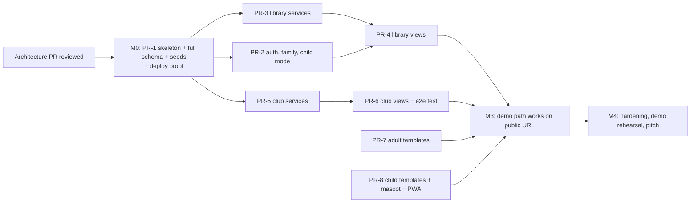

# Execution plan after architecture review (proposal)

**Not a task backlog.** This is the roadmap to start controlled parallel work once Issue #7 review approves the architecture. Detailed `tasks.md` is generated afterwards. Hackathon deadline is `[UNKNOWN]`; durations are estimates for AI-assisted developers.

## Critical path

| Milestone | Exit criterion (observable) | Est. |
|---|---|---|
| **M0** | PR-1 merged; `uv run pytest` green on empty suite + model tests; `seed_demo` runs; app reachable on the chosen host over HTTPS; a DB write survives restart; admin login works | 1.5–2 h |
| **M1** | Services merged with unit tests: authz/child mode, progress (idempotent, ranges), membership + achievements | +2–3 h |
| **M2** | Views wired to templates; `tests/test_demo_flow.py` passes end-to-end via test client | +2–3 h |
| **M3** | Manual demo script in [quickstart.md](./quickstart.md) passes on a real phone + laptop against the public URL | +1 h |
| **M4** | Counter-example checklist executed and reported; demo-ready tag; fallback rehearsed | +1–2 h |

## Workstreams and ownership

Assignment by dependency and by keeping shared files with one owner; the AI tool is not treated as a role.

| Person (tool) | Workstream | PRs | Owns (only they edit) | Depends on |
|---|---|---|---|---|
| **Арсений** (Claude Code) | Foundation + identity/security | **PR-1** skeleton: `pyproject`, `config/*`, custom `Account`, **all models + initial migrations for all apps**, admin registration stubs, `core/viewmodels.py`, stub `club.services.evaluate_achievements()` returning `[]`, debug-only `/_preview/<template>/` route, `seed_demo` · **PR-2** signup/login, family CRUD, PIN, `ChildModeMiddleware`, `pin_gate`, `accounts/authz.py` + `test_authz.py`, `test_child_mode.py` | `config/`, `apps/accounts/`, all `models.py` + migrations until M1 (later changes = decision gate), `core/viewmodels.py` | Architecture approval |
| **Алиса** (Codex) | Reading domain | **PR-3** `library/services.py` (`add_to_shelf`, `record_progress`, `finish_book`), `library/stats.py` + `test_progress.py`, `test_stats.py` · **PR-4** library views/urls (catalog, book detail, add, shelf, shelf entry, progress, finish) choosing `adult/` or `child/` templates by mode | `apps/library/` (except models after M0) | PR-1 (models), PR-2 for `current_reader` (can mock it in tests until then) |
| **Игорь** (Codex + Antigravity, separate worktrees) | Club, entitlement, integration, deploy | **PR-0** (parallel to PR-1, no code in repo): create host account, verify HTTPS, env vars plan · **PR-5** `club/services.py` (`is_member`, `redeem_code`, `evaluate_achievements`), admin actions (issue codes showing plaintext once, revoke) + `test_membership.py`, `test_achievements.py` · **PR-6** club views (redeem, achievements, club corner), deploy script/docs, `tests/test_demo_flow.py` | `apps/club/` (except models after M0), deploy docs, `tests/test_demo_flow.py` | PR-1; PR-3 for e2e |
| **Владимир** (Antigravity) | Adult UX + design system + i18n | **PR-7** `templates/base.html`, `_toast.html`, design tokens in `static/css/app.css`, all `templates/adult/*`, HTMX error/toast handling in `static/js/app.js`, `locale/ro` catalog (runs `makemessages` at M3) | `templates/base.html`, `templates/adult/`, `static/css/app.css` tokens section, `static/js/app.js`, `locale/` | Context contracts only (works with `/_preview/` after PR-1) |
| **Денис** (Antigravity) | Child UX, mascot, PWA, demo | **PR-8** `templates/child/*`, child styles (own CSS section/file `static/css/child.css`), mascot + avatars assets, `core/mascot.py` script (keys from routes contract), `manifest.webmanifest`, `sw.js`, `/offline/` · **PR-9** demo script polish, screenshots with synthetic data, pitch visuals | `templates/child/`, `static/css/child.css`, `static/img/`, `static/sw.js`, manifest, `apps/core/mascot.py`, `apps/core/pwa.py` | Context contracts only; PR-1 for preview |

### Before PR-1 merges (no blocking)

- Vladimir and Denis design screens (Figma/paper/HTML prototypes) from the [context contracts](./contracts/routes.md#template-context-contracts-for-parallel-ui-work) and the mascot script.
- Alisa and Igor write their service functions and tests against [data-model.md](./data-model.md) in branches based on PR-1's branch (rebase after merge).
- Igor proves the host (PR-0 notes in the PR description, no secrets).

### Files nobody edits concurrently

| File / area | Single owner | Others do instead |
|---|---|---|
| `config/settings/*`, `config/urls.py` | Arsenii | Request a change in the PR thread; app URLs live in `apps/<app>/urls.py` already included by PR-1 |
| `apps/*/models.py`, migrations | Arsenii until M1, then app owner **with a decision-gate note** | Propose field changes in the PR; never run `makemigrations` for another app |
| `core/viewmodels.py` | Arsenii | Ask for new fields |
| `templates/base.html`, CSS tokens | Vladimir | Child styles go in `child.css` |
| `locale/` | Vladimir | Wrap strings in `` / `gettext` only |
| `pyproject.toml` / `uv.lock` | Arsenii | Ask before adding a dependency |

### PR rules

- Branch from `main` after PR-1 (`feat/<area>-<short>`), small PRs, `Refs #7`.
- Each PR lists the exact commands run (`uv run pytest …`, `uv run python manage.py check`) and their real output.
- Review by ChatGPT (independent) or a teammate; no self-merge.

## Smoke / e2e scenario (automated in `tests/test_demo_flow.py`, repeated manually in M3)

1. `seed_demo --reset`.
2. Guardian signs in → creates child → sets PIN → starts child mode.
3. Child adds book (120 p) → saves page 35 → page 35 persisted → replay same `request_id` → no change.
4. New client session as guardian → child report shows 35/120 and pages_7d = 35.
5. Child finishes book → `first-book` granted; `club-reader` **not** granted (not a member).
6. Guardian (after PIN) redeems code for child → membership active → `evaluate_achievements` grants `club-reader` once.
7. Child opens club corner → 200; second child (non-member) → 403.

Test file owners not listed above: `tests/test_i18n.py` — Vladimir; `tests/test_seed.py` — Arsenii.

Failure checks (manual + tests): out-of-range page, foreign IDs (404), adult URLs in child mode (redirect to PIN gate), wrong PIN ×5 (lock), used/expired code (generic error), network off (no "saved"), revoked membership (club corner denied).

## Fallbacks (honest)

| Failure | Fallback | What we say |
|---|---|---|
| Public host fails (HTTPS, limits) | Second host option from research (Render + free Postgres), else laptop | "Running on our laptop; data is real and persisted locally, not yet publicly deployed" |
| Child mode middleware unstable | Keep PIN gate, temporarily limit child mode to the 4 child pages via allow-list only | Same security claim must still pass counter-examples 3; if not, do not claim it |
| HTMX issues | Plain form POST + redirect (same views) | Slightly less smooth UI |
| Time runs out before club flow | Admin activates membership manually during demo | Code redemption shown as "next" |

Never replace the database with browser storage to "make the demo work".

## High-upside after P0 is stable (do not expand P0)

- Animated mascot reactions and confetti on achievements (Denis).
- Scripted onboarding dialogue: mascot asks interests, answers by buttons → rule-based book suggestions (P1).
- Visual reading map / book passport stamps (Denis, Vladimir).
- Russian UI (Vladimir).
- Mentor-side AI quiz drafts behind human approval (Deferred; architecture leaves room: new `quiz` app, no child-facing generation).
- Pitch: problem stats (PISA reading) to be verified before use; demo video as backup.
