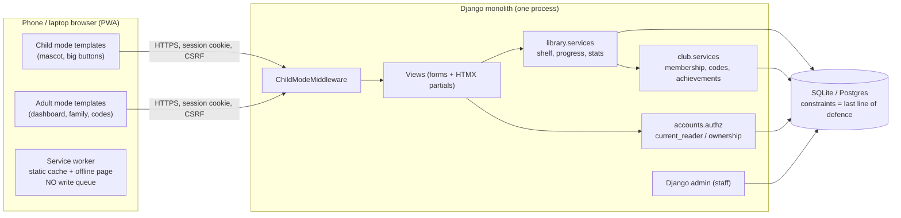

# Implementation Plan: Gustul Cărților — P0 reading-diary vertical slice

**Branch**: `001-reading-diary-mvp` | **Date**: 2026-10-30 | **Spec**: [spec.md](./spec.md)

**Input**: Feature specification from `/specs/001-reading-diary-mvp/spec.md`

**Status**: Architecture proposal for independent review (Issue #7). No application code exists yet.

## Summary

One Django 5.2 LTS monolith serving a mobile-first, installable PWA with two presentation modes (child / adult) over one domain model. A `Reader` abstraction unifies adult and child shelves; guardian ownership and club membership are independent, server-checked axes. Progress writes are idempotent and persisted before success is shown; achievements are granted only by server rules backed by DB uniqueness. Rationale and alternatives: [research.md](./research.md) and [ADR-0001](../../docs/adr/0001-architecture-gustul-cartilor-mvp.md).

## Technical Context

**Language/Version**: Python 3.12

**Primary Dependencies**: Django 5.2 LTS; HTMX 2.x (vendored static file); `whitenoise` for static files; `gunicorn` for production serving; `dj-database-url` (only if a Postgres host is chosen). Dependency management with `uv` (`pyproject.toml` + `uv.lock`).

**Storage**: SQLite (WAL) for dev and demo on a persistent disk; PostgreSQL-compatible schema; switch via `DATABASE_URL`.

**Testing**: Django test runner via `pytest` + `pytest-django`; Django test client for end-to-end server flows; manual phone checklist in [quickstart.md](./quickstart.md).

**Target Platform**: Linux host (PythonAnywhere free as the primary proposal; Render + Postgres or laptop as fallbacks); clients are mobile Chrome/Safari and desktop browsers.

**Project Type**: Web application (server-rendered PWA).

**Performance Goals**: Page TTFB < 500 ms on the demo host for ≤ 100 concurrent users; progress save round trip < 1 s on 4G.

**Constraints**: No offline writes; no external service required at runtime; no PII in logs; Romanian UI strings via gettext; 360 px minimum width; tap targets ≥ 48 px in child mode.

**Scale/Scope**: Demo scale (~70 families reported by the club); ~18 routes, 11 tables, 2 template sets.

## Constitution Check

*GATE: Must pass before Phase 0 research. Re-check after Phase 1 design.*

| Principle | Check | Status |
|---|---|---|
| I. Demo-first E2E | P0 = one vertical slice (child logs → parent sees → member unlocks); everything else P1/Deferred | Pass |
| II. Time-boxing / critical path | Critical path and milestone M0–M4 defined in [execution-plan.md](./execution-plan.md) | Pass |
| III. Shared contracts & decision gates | Single-source contracts in `data-model.md` and `contracts/`; gates G1–G6 listed; schema owned by one engineer | Pass |
| IV. Parallel work | Django apps + template sets as module boundaries; file ownership table | Pass |
| V. Honest checks | Each counter-example mapped to a named test or manual step; nothing marked PASS | Pass |
| VI. Fact-based reasoning | Partner facts labelled; versions/hosting facts cited or marked unverified | Pass |
| VII. Pragmatic SDD | `tasks.md` intentionally not generated before review (see below) | Pass |
| VIII. Security & compliance | No secrets/PII committed; synthetic seeds; env-based credentials | Pass |

Note: `AGENTS.md`/`CLAUDE.md`/`README.md` still say the stack is "TBD". They are left unchanged in this PR; after review approves the stack, a follow-up PR updates them (constitution §VI says stack decisions remain deferred until accepted).

## Architecture

### Components



### Data flow: child saves progress → guardian sees it

```mermaid
sequenceDiagram
    participant C as Child (phone, child mode)
    participant S as Django
    participant D as DB
    participant P as Guardian (laptop, adult mode)
    C->>S: POST /raft/{entry}/progres/ page=35, request_id=U1 (CSRF)
    S->>S: ChildModeMiddleware: route allowed
    S->>S: authz.current_reader = active child (re-validated vs guardian)
    S->>D: BEGIN; SELECT entry FOR UPDATE WHERE public_id & reader
    S->>D: INSERT ProgressEvent(reader, U1) — unique; on conflict → replay
    S->>D: UPDATE entry current_page=35
    S->>D: evaluate_achievements(reader) — is_member(now), INSERT grants (unique)
    S->>D: COMMIT
    S-->>C: 200 partial: bar 29%, mascot "progress_saved", new grants
    Note over C: Only now does the UI show "saved"
    P->>S: GET /familie/{child}/ (adult session)
    S->>D: child WHERE public_id AND guardian = user; stats from DB
    S-->>P: 35/120, pages_7d updated
```

## Project Structure

### Documentation (this feature)

```text
specs/001-reading-diary-mvp/
├── spec.md              # WHAT: stories, FRs, P0/P1/Deferred, gates
├── plan.md              # This file
├── research.md          # Stack + hosting comparison, verified facts
├── data-model.md        # Tables, invariants, services, seeds
├── quickstart.md        # Setup (post-M0), demo script, security counter-examples
├── execution-plan.md    # Critical path, 5-person workstreams, PR map
├── checklists/
│   └── requirements.md  # Spec quality checklist
└── contracts/
    ├── routes.md        # Page map, mutations, template contexts, mascot script
    └── authorization.md # Actor × operation matrix, child mode, membership lifecycle
```

`tasks.md` is **not** generated in this PR: the review gate must approve the architecture first (Issue #7). After approval, `/speckit-tasks` produces it from these documents.

### Source Code (repository root) — to be created in M0, not in this PR

```text
pyproject.toml, uv.lock, manage.py, .env.example
config/                 # settings (base/dev/prod), urls.py, wsgi.py      — owner: Arsenii
apps/
├── accounts/           # Account, ChildProfile, Reader, PIN, ChildModeMiddleware, authz.py — Arsenii
├── library/            # Book, ShelfEntry, ProgressEvent, services.py, stats.py, views   — Alisa
├── club/               # ClubMembership, MembershipCode, Achievement(+Grant), ClubActivity,
│                       # services.py (redeem, evaluate), admin.py, views                — Igor
└── core/               # viewmodels.py, mascot.py (script), PWA views, seed_demo command — Denis (mascot/PWA), Arsenii (viewmodels)
templates/
├── base.html, _toast.html                       # shared shell                     — Vladimir
├── adult/                                       # dashboard, family, child_report, redeem, catalog — Vladimir
└── child/                                       # home, catalog, shelf_entry, _progress, achievements — Denis
static/
├── css/app.css, js/htmx.min.js, js/app.js       # design tokens shared             — Vladimir (tokens), Denis (child styles)
├── img/mascot/, img/avatars/, icons/            #                                  — Denis
└── sw.js, manifest.webmanifest                  #                                  — Denis
locale/ro/, locale/ru/                           # gettext catalogs                 — Vladimir
tests/
├── test_authz.py, test_child_mode.py            # Arsenii
├── test_progress.py, test_stats.py              # Alisa
├── test_membership.py, test_achievements.py     # Igor
└── test_demo_flow.py                            # Igor (end-to-end via test client)
```

**Structure Decision**: single Django project with four apps; templates split by mode, not by app, so the two UI owners never edit the same files.

## Key design decisions (detail in ADR-0001)

1. **Reader abstraction** — one shelf model for adults and children; ownership via one function.
2. **Child mode = server-side session mode + middleware allow-list + PIN gate**, not a UI toggle.
3. **Membership = time-bounded entitlement rows**, computed per request; codes hashed and single-use; admin back office for activation/revocation.
4. **Writes are idempotent** (`request_id` unique per reader) and **transactional** (`select_for_update`), and stats are derived from stored data only.
5. **Achievements are server-evaluated** after stored changes, unique per reader, members-only rules check `is_member` at evaluation time.
6. **One contract style**: HTML forms + HTMX partials; no parallel JSON API.
7. **PWA without offline writes**; visible failure states.
8. **i18n from day one** (`gettext`, `LANGUAGE_CODE="ro"`); Russian catalog P1.

## Errors, loading, offline, logging, accessibility

- HTMX requests show an inline spinner via `hx-indicator`; buttons are disabled during requests (`hx-disabled-elt`).
- 422 → partial with field messages; 403/404 → friendly page (child variant uses the mascot `oops` line); 429 → lockout message with remaining time; 5xx → generic page + toast.
- Offline: service worker serves `/offline/` for navigations when the network fails; HTMX `htmx:sendError` → toast "Nu s-a salvat".
- Logging: Django logging to stdout; a filter strips emails; only `reader.public_id`, route name and status are logged. No request bodies.
- Accessibility: semantic HTML, labels on all inputs, contrast ≥ 4.5:1, focus styles, mascot text duplicated as plain text (not only an image), `lang="ro"` on `<html>`.

## Environments, secrets, deploy, rollback

| Env | DB | Settings | Secrets |
|---|---|---|---|
| dev (each laptop) | `db.sqlite3` (git-ignored) | `config.settings.dev`, `DEBUG=True` | `.env` from `.env.example` (git-ignored) |
| demo (public) | SQLite on persistent disk or Postgres | `config.settings.prod`, `DEBUG=False`, `ALLOWED_HOSTS`, secure cookies | `DJANGO_SECRET_KEY`, `DEMO_PASSWORD`, `DEMO_PIN` in host env vars only |

Deploy: `git pull` (or host's git integration) → `uv sync --frozen` → `migrate` → `collectstatic` → reload. Rollback: redeploy previous tag + restore the DB copy taken before `migrate` (`cp db.sqlite3 db.backup-<time>.sqlite3`). Demo safety: a tagged "demo-ready" commit; `seed_demo --reset` recreates synthetic data in < 10 s; laptop fallback with the same tag.

## Complexity Tracking

| Violation | Why Needed | Simpler Alternative Rejected Because |
|---|---|---|
| `Reader` indirection table | Adults and children both own shelves; one ownership rule | Two parallel shelf models would double services, stats and tests |
| `ProgressEvent` log in P0 | Idempotency key storage and "pages in 7 days" | Storing only `current_page` cannot deduplicate retries or show weekly progress |
